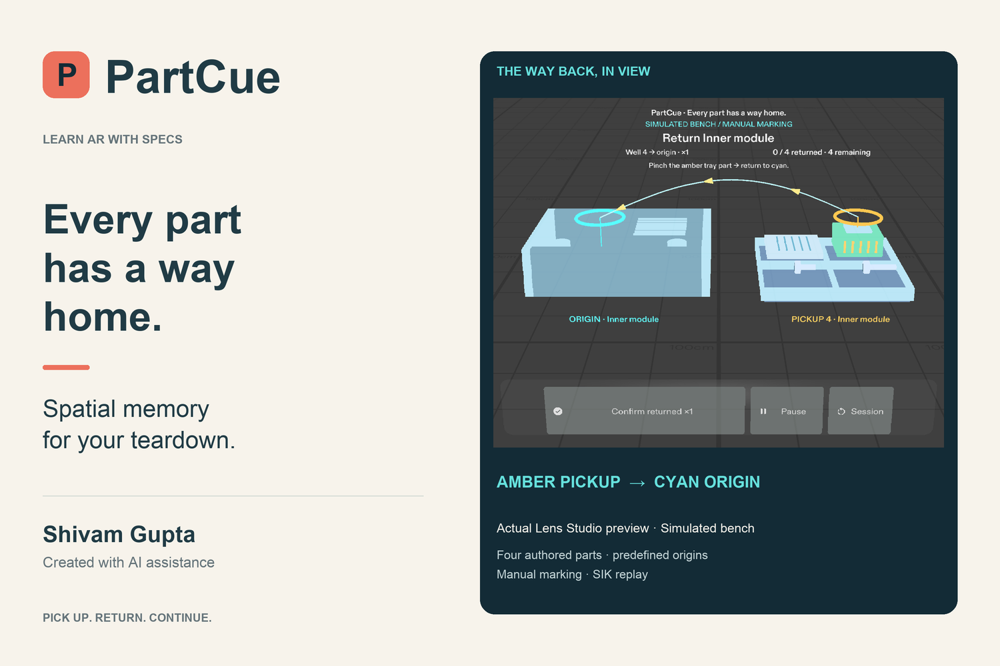

# PartCue

### Every part has a way home.

Two similar screws. Two different origins. PartCue remembers the relationship while you take something apart—and shows one way back at a time.

[](https://www.youtube.com/watch?v=Z9rPXUwUdnw)

[Watch the 2:32 demo](https://www.youtube.com/watch?v=Z9rPXUwUdnw) · [Public source](https://github.com/shi1720/partcue) · [34-check CI](https://github.com/shi1720/partcue/actions/runs/39416731639)

The **SPECS Lens** records explicit selections among four authored parts and their predefined origins into a four-well demonstration tray. During return, an amber pickup cue and cyan origin cue are joined by an animated path beside the work. The sequence comes from your own teardown, with selection and quantity confirmation before each step advances.

**Created by Shivam Gupta, developed with AI coding assistance.** Built for Learn AR with SPECS, starting 20 October 2026.

**Built and tested:** Snap CLAD and the official Lens Studio MCP; six functional LEAF scenarios, including the new selection guard, plus a no-fallback IK scenario; **34/34** software checks with passing public CI. All seven functional/IK Lens scenarios passed on the saved selection-guard revision. [Preview evidence and exact results](docs/lens-build-report.md).

Public source: [shi1720/partcue](https://github.com/shi1720/partcue), tested code revision [`a6c74c7`](https://github.com/shi1720/partcue/commit/a6c74c7). [CI passes all 34 checks](https://github.com/shi1720/partcue/actions/runs/39416731639).

## Try the Lens

1. Install **Lens Studio 5.24.1** or a compatible version supporting SPECS 27.
2. Open [PartCue.esproj](lens/PartTrail/PartCue.esproj). Allow Lens Studio to rebuild its generated caches and definitions. The project includes the authored scene, scripts, procedural geometry, feedback audio, icons, SIK/UIKit and LEAF dependencies.
3. Select **SPECS 27 / Interactive** preview. Set the bench, start a teardown, select a part and an empty well, then record its removal. Repeat for four parts.
4. Start return mode. Select the highlighted next part and confirm its recorded quantity. Try a wrong part or quantity, then pause/resume and undo. Complete the reverse sequence and confirm restart.

The permanent **SIMULATED BENCH / MANUAL MARKING** label identifies the preview fixture. Origins are predefined for these four demonstration parts; this build does not capture arbitrary real repair locations. Recorded proof uses actual runtime SIK/UIKit interactions replayed by a scenario, not a live human hand recording. Completion records user acknowledgments; the Lens does not recognize screws or verify a physical installation. Reverse order is a memory aid, and may differ from a manufacturer's assembly procedure.

For development, use the included [design brief](devpost/design-brief.md), Snap's [CLAD setup](https://developers.specs.com/docs/clad/setup/setup-ai/codex-setup), and the actual build and LEAF reports inside the Lens project's `devpost/` directory. See [validation](docs/validation.md) and the [submission audit](docs/rubric-audit.md) for the evidence boundary.

## Run the companion

The optional browser companion provides a 3D rehearsal, real local accounts, saved sessions and JSON import/export. It is separate from the Lens; there is no automatic Lens-to-companion synchronization.

Requires **Node 22.16+ within Node 22**, npm and a modern browser with WebGL2. No API keys, runtime LLM calls or paid services are required.

```sh
npm ci
npm run build
npm test
npm start
```

Open the printed loopback URL, normally `http://127.0.0.1:4173`. Try a guest rehearsal or register a local account with a 12–128 character password. There are no seeded credentials. Accounts and saved logs persist in the ignored `data/` SQLite directory. Save explicitly or export before closing guest work.

Tests cover the sequence rules, explicit clearing of a stale return selection, exact Lens-core source parity, API client races, real HTTP authentication, account isolation, snapshot validation, concurrent revisions, persistence and backup restoration. The companion's browser workflow was also exercised end to end. These checks complement the Lens's separate runtime tests.

## How it fits together

| Area | Role |
| --- | --- |
| [lens/](lens/) | Actual SPECS Lens Studio project, scene, UIKit/SIK interactions, generated assets and live LEAF scenarios |
| [core/](core/) | Immutable session state machine; the Lens includes an exact source copy checked by tests |
| [web/](web/) and [server/](server/) | Browser rehearsal and account-owned SQLite snapshots |
| [devpost/](devpost/) | Devpost Learn planning output |
| [Architecture](docs/architecture.md) | State ownership, adapter boundaries and failure behavior |
| [Validation](docs/validation.md) | Automated checks and observed browser workflows |
| [Security and deployment](docs/security-and-deployment.md) | Free local setup, backups and public-deployment requirements |
| [Submission draft](docs/submission-draft.md) and [video script](docs/video-script.md) | Pitch, learning narrative and recording plan |
| [Build provenance](docs/build-provenance.md) and [rubric audit](docs/rubric-audit.md) | Tools used, evidence and remaining submission gates |

## First users and commercial test

Independent repair benches and classrooms are the first users to test. The proposed benefit is seeing a part's pickup location and origin together, beside the task, rather than mentally translating a list into positions. A reverse teardown log is not a new invention: [an existing direct alternative](https://github.com/KanadeK/parttrail/blob/main/README.md) already describes that workflow. Labeled mats, bags and photographs are strong inexpensive alternatives too.

The commercial experiment is **$20 per active bench per month**, unvalidated. A pilot must compare spatial cues with both usual methods and a plain reverse checklist, counting recording overhead. No customer demand, time savings or established moat is claimed. See [research](docs/market-research.md) and the [commercial plan](docs/commercial-plan.md).

Preview tests establish the observed software behavior. Glasses comfort, real bench alignment, physical hand tracking and repair benefit still need hardware and users. The companion is a tested local release, not an audited public SaaS deployment.

## Submission

[Public demo, 2:32](https://www.youtube.com/watch?v=Z9rPXUwUdnw) and [source with passing CI](https://github.com/shi1720/partcue) are ready. The video uses actual native Lens Studio recordings, replayed SIK/UIKit inputs and a disclosed generic synthetic guide; it does not impersonate Shivam or show camera recognition. Final post-guard workflow and continuous spatial footage are included in the production record.

Deadline: **10 November 2026, 03:30 IST**. The remaining participant step is Shivam's review of the entry, personal Additional info responses and truthful eligibility attestations and **Devpost Submit**. Submission is not claimed complete.


MIT license for original PartCue code. See [third-party notices](THIRD_PARTY_NOTICES.md) for package and asset disclosures.
