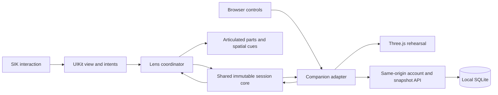

# Architecture and failure boundaries

PartCue has two adapters around the same dependency-free session rules. The SPECS Lens is the hackathon artifact. The companion is a separate local account service and browser rehearsal.

The Lens does not call the account server. There is no automatic Lens/companion transfer or persistent spatial-anchor claim. Both run without runtime LLM inference or API keys.

## One authority for the sequence

`core/index.ts` implements explicit commands and phases: setup, recording, returning, paused, and complete. Every accepted command produces a new validated snapshot. Rejection returns a recoverable error and preserves the prior snapshot. Return order comes from the actual removal array; selection and the exact recorded quantity are required before a confirmation can advance it.

The Lens includes an exact copy of this portable source in its Assets scripts. `tests/lens-parity.test.mjs` compares the two files, so the domain tests cannot silently cover a different version from the Lens. Lens compilation and LEAF still matter: byte parity alone cannot establish runtime compatibility or interaction behavior.

UI code emits intents and renders derived state. Procedural geometry only displays the state and animates between positions. It does not decide that a physical part has been returned. LEAF scenarios interact through actual SIK/UIKit targets and inspect public snapshots plus runtime scene/text state; they do not invoke private controller actions.

## Meaningful failures

| Boundary | Behavior |
| --- | --- |
| Wrong part, missing selection, wrong count | No progress change; explain the expected next action. |
| Pause | Hide work cues, block repair actions, and clear a pending confirmation. Resume requires fresh selection. |
| Incorrect confirmation | Undo restores the previous return pair, including after completion. |
| Malformed or oversized JSON | Reject it and preserve the current bench. Valid imports receive a fresh id before saving. |
| Stale server revision | Reject the overwrite with a conflict; retain the tab's unsaved session. |
| Another tab changes account | Pin API reads and writes to the identity displayed in this tab. Reject a different cookie account before returning its data. Preserve local work. |
| Unavailable server | Keep guest work in memory; allow JSON export. No false saved indicator. |
| Unavailable persistent storage | Fail server startup or the transaction; never silently substitute volatile storage for a successful save. |
| Moved real bench or tracking loss | Not automatically detected in this preview build. User confirmations do not establish alignment or physical correctness. Device validation remains necessary. |

## Stored data and operational scope

Accounts contain an email identifier, optional display name, and salted scrypt password hash. Session tokens are opaque, stored as hashes on the server, and sent in HttpOnly cookies. CSRF and same-origin checks protect authenticated mutations; parameterized SQL and owner checks isolate snapshots. Optimistic revisions prevent a stale tab from replacing newer work. Snapshots are validated and bounded before storage.

The SQLite database and backups are local files, with restrictive filesystem permissions rather than application-level encryption. The backup utility includes committed WAL data and checks the restored database. Public SaaS hosting, verified email, account recovery, MFA, deletion operations, distributed abuse controls, and an external security audit remain outside this tested local release. See [security and deployment](security-and-deployment.md).

## Repeatable build and evidence

1. `npm ci` installs pinned companion/build dependencies.
2. `npm run build` compiles the core and creates a same-origin browser bundle; no CDN is required at runtime.
3. `npm test` exercises the domain, exact Lens-source parity, API client, actual HTTP/SQLite integration, persistence, and backup restoration.
4. Open the included project in Lens Studio and allow its generated caches/definitions to rebuild. Project-local MCP credentials are generated by the editor and excluded from source control.
5. Use CLAD and official Lens Studio MCP to compile, inspect the actual scene, run LEAF serially, and capture runtime evidence. A browser test never stands in for this step.
6. Review the final video against visible behavior and the [rubric audit](rubric-audit.md). Publish only source and intentional demonstration assets, excluding credentials, account databases, generated caches, and private editor logs.

The generated WAVs and icons are included. SFX regeneration is optional and uses the installed CLAD tools; it is not required to open or run the Lens.
