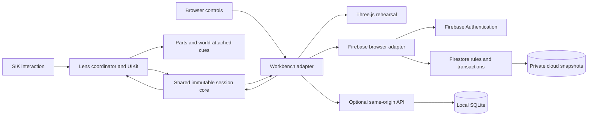

# Architecture and failure boundaries

PartCue has a SPECS Lens and a browser workbench around the same portable session rules. The Lens is the hackathon artifact. The public browser workbench at [partcue.web.app](https://partcue.web.app) adds private accounts and explicit cloud saves. An optional Node/SQLite server preserves a fully local mode.

The hosting build selects the Firebase adapter; the ordinary local build selects the HTTP adapter. These are separate stores. Explicit JSON export/import transfers a copy. The Lens does not call either account service, and its session is not automatically synchronized with the workbench. No runtime LLM inference is required. Firebase's public web configuration identifies the hosted project; it is not an administrative secret.

## One authority for the sequence

`core/index.ts` implements explicit commands and phases: setup, recording, returning, paused and complete. Accepted commands produce a new validated snapshot. Rejected commands preserve the prior snapshot. Return order comes from the removal array; selection and the exact recorded quantity are required before confirmation advances it. A wrong selection is followed by an explicit successful deselection, preventing an earlier correct choice from remaining confirmable.

The Lens includes an exact copy of this portable source. `tests/lens-parity.test.mjs` checks byte parity. Lens compilation and live LEAF/SIK checks establish the separate runtime and interaction evidence. UI code emits intents and renders derived state. Geometry displays and animates state; it does not identify real objects or verify a physical return. The Lens currently demonstrates four authored parts and predefined origins. Browser session data can describe manually entered jobs within the shared schema bounds.

## Cloud storage and authorization

Firebase Authentication manages hosted email/password identities. The adapter pins operations to the account shown in the tab and observes Auth changes across tabs. Private documents live at `users/{uid}/sessions/{sessionId}`. Firestore rules derive ownership from the authenticated UID, deny anonymous access and cross-owner enumeration, and require exact storage fields, bounded UTF-8 JSON, typed summaries, timestamps and revision increments.

Each account has at most 50 saved sessions. A private metadata document records a counter and mutation ID. Create/delete transactions change one session and its counter together; rules verify the matching before/after document, preventing a forged count or multi-create batch from bypassing the quota. Updates compare the loaded revision and increment it once. Server-only reads and transactions make an unavailable cloud service an explicit failure rather than an offline save acknowledgement.

Full snapshot domain validation runs in the shared TypeScript core before writes and after restores. Rules validate the storage envelope, not the opaque JSON's domain semantics. An owner using a modified SDK client can corrupt their own JSON or summary; they cannot thereby access another UID. The workbench refuses invalid restored snapshots. The optional SQLite service additionally runs the core on the server before storing data.

Account deletion reauthenticates, permanently locks the UID's storage, removes all session documents, clears the last mutation ID, then deletes the Auth account. A minimal private deletion marker remains indefinitely: `schemaVersion:1`, `sessionCount:0`, `deleting:true`, `mutationId:null`, `createdAt` and `updatedAt`, under the former UID path. It contains no repair content, email or display name. Clients cannot remove or reset it. This closes the window in which an old tab or still-valid ID token could recreate jobs after cleanup. Auth and Firestore deletion are not one atomic transaction; an interrupted deletion can be retried while the account still exists.

## Meaningful failures

| Boundary | Behavior |
| --- | --- |
| Wrong part, missing selection, wrong count | Preserve progress; clear stale selection after a wrong attempt and explain the next action. |
| Pause | Hide work cues, block repair actions and clear pending confirmation; resuming requires selection. |
| Incorrect confirmation | Undo restores the previous return pair, including after completion. |
| Invalid or oversized JSON | Reject it and preserve the current bench; valid imports receive a fresh ID. |
| Stale saved revision | Reject the overwrite; keep the tab's unsaved work for export or deliberate reload. |
| Account changes in another tab | Reject operations pinned to the earlier UID; discard delayed account data rather than display it under the new account. |
| Cloud unavailable or quota reached | Keep current work, report the failure and allow JSON export. A timeout may require checking saved sessions before retrying. |
| Page reload | Recover current browser work from tab-scoped session storage when available; JSON export remains the portable backup. |
| Local persistent storage unavailable | Fail startup or the transaction; never silently substitute volatile storage for a successful save. |
| Moved bench or tracking loss | Not automatically detected in this preview build. Confirmation does not establish alignment or mechanical correctness. |

## Repeatable builds and evidence

Use `npm ci`, `npm test` and `npm run test:firebase` for the core/local suite and actual Firebase Auth/Firestore emulator suite. `npm run build` builds local mode; `npm run build:hosting` builds the hosted adapter. The Firebase suite currently has 12 tests, including stale-token recreation after deletion, quota forgery, concurrent first saves, cross-owner access and revision races. Open the included project separately in Lens Studio for compilation and the seven live LEAF checks. Browser results cannot substitute for Lens preview verification.

The local API, backup and threat boundaries are documented in [the server guide](../server/README.md). Hosted configuration and deployment gates are in [Firebase deployment](firebase-deployment.md); the shared operational limitations are in [security and deployment](security-and-deployment.md).
