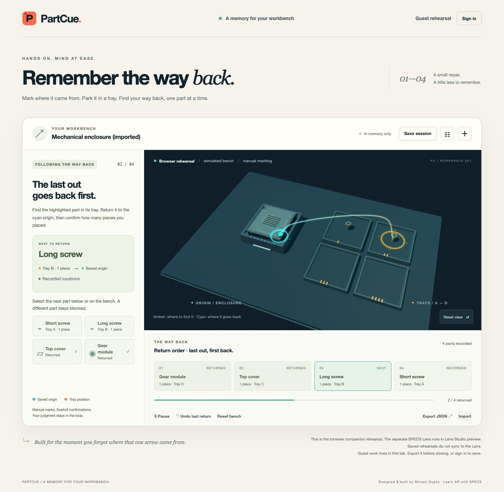

# Validation record

Observed on 20 October 2026. This file separates the browser companion from the SPECS Lens. Lens runtime evidence is recorded in [the Lens build report](lens-build-report.md).

## Companion build and automated checks

Environment: macOS ARM, Node 22.16.0. `npm run build` compiled the shared TypeScript core and bundled the browser app without external runtime requests. The final checks below include the independent review fixes.

The tests exercise the core and actual HTTP servers backed by temporary SQLite files. They cover command validation, reverse ordering, exact quantity, pause/resume, undo, rejected-action immutability, malformed imports, history/size limits, durable restart, password hashing, account ownership, CSRF, session revocation and expiry, rate/body limits, static path traversal, concurrency, and backup/restore. These are not LEAF tests.

**Final software checkpoint: 34/34 tests passed locally and in public CI**, including the stale-selection core and actual browser-handler regressions, exact Lens-core parity, cross-tab account-switch isolation, late authentication-response protection, and the browser fetch-receiver regression. `npm audit --omit=dev` reported zero known vulnerabilities in the runtime dependency set at the earlier 32-check review; that is an advisory lookup, not a security certification.

Public source: [shi1720/partcue](https://github.com/shi1720/partcue), tested code revision [`a6c74c7`](https://github.com/shi1720/partcue/commit/a6c74c7). [CI passes all 34 checks](https://github.com/shi1720/partcue/actions/runs/39416731639).

Independent reviews also verified the running app in Chrome at 320 px and 1512 px widths, with no horizontal overflow and all four tray wells visible. Keyboard focus now survives selection-list redraws, recording, pause/resume, and completion. Registration, saving, listing, and logout were exercised against the current server. Four dialogs have accessible names and descriptions. A real-browser fetch binding bug was found and fixed even though injected-fetch tests had passed; the added regression test retains the global receiver.

## Browser observations

Tested the running local companion at `http://127.0.0.1:4173` through browser UI controls. Test accounts used disposable, invented `.example.test` addresses and random test passwords. No real personal account or password is included in the project.

| Workflow | Observed result |
| --- | --- |
| Four removals | Recorded the short screw, long screw, top cover, and gear module into distinct wells; the scene moved each part into its chosen well. |
| Reverse return | Gear module was first; the paired route connected its tray position and origin. |
| Wrong part | Selecting the short screw left progress at 0/4 and identified the expected gear module. |
| Wrong selection after correct selection | In a fresh tab running the rebuilt bundle, selected Long screw, then attempted Short screw. Both selections were unchecked, the confirmation form disappeared and progress stayed at 0/2. Fresh correct selection is required. |
| Wrong quantity | Confirming two pieces where one was recorded left progress at 0/4. |
| Correct confirmation | Selecting the expected part and confirming one advanced exactly once. |
| Pause/resume | Paused after one return; work cues disappeared. Resume restored the next top-cover step. |
| Undo and completion | Undo restored the prior gear-module return. Confirmed all four returns and observed completion. |
| Real registration and save | Registered a disposable local account from the save dialog; the completed session saved successfully. |
| Reload and load | Reload retained the authenticated cookie; saved session loaded with four confirmed returns and revision 1. |
| Revisions | Undo and save advanced the revision. A second tab holding an old revision was blocked from overwriting a newer save, and retained its unsaved work. |
| Export/import | Exported a real session JSON and imported it as a fresh session. The validated example is committed at `examples/returning-session.json`. |
| Invalid import | A malformed snapshot was rejected while the active two-of-four return session remained intact. |
| Rename and final layout | Opened the rebuilt app and verified the PartCue name, P mark, PC workspace label, and footer. Imported the example again and verified coordinates are available under an optional Recorded locations disclosure. Captured the actual browser rehearsal below. |

This screenshot is browser evidence only. Virtual part movement is driven by the user's explicit commands. It does not show camera recognition or verify physical assembly.

## Selection-guard evidence

The strict review reproduced a stale confirmation: selecting the correct part and then attempting a wrong pickup left the old selection armed. The fix keeps the rejected command immutable, then records an explicit successful `deselectReturn` command and `return-deselected` event. It changes no part list or progress count. The browser clears the count input and hides its confirmation form until a new correct selection.

The regression checks the complete sequence: correct selection → rejected wrong attempt → explicit deselection → confirmation rejection → fresh correct selection → exactly one accepted return. A second test executes the shipped browser transition handler with the real domain core. The Lens includes the same exact core source; all seven functional/IK scenarios passed on the saved guard revision, including this new regression.

Actual browser observation: [selection guard screenshot](evidence/companion-selection-guard.png) and [accessibility-state evidence](evidence/companion-selection-guard.txt). An older tab had unsaved-work navigation protection, so the verification used a fresh tab and the rebuilt bundle rather than assuming that a reload had succeeded.

## Native Lens captures and spatial proof

The native Lens Studio recorder produced actual workflow footage in `demo/raw/partcue-workflow-full.mp4` (1570 × 1590, 116.632 seconds) and a separate continuous spatial recording in `demo/raw/partcue-spatial.mp4`. These are source captures; the completed public narrated demo is linked below.

The [corrected spatial evidence](../lens/PartTrail/devpost/spatial-video-evidence-corrected.json) reports success: during the camera move, measured world-position deltas for the bench root and both active halos are zero. A subsequent actual pickup and confirmation advances 1/4 → 2/4, changes the cue pair from Lid/Well 3 to Long screw/Well 2 and preserves the work root. The earlier partial observation is retained rather than presented as a successful run.

The fixture contains four authored parts with predefined origins. Scenario replay supplies explicit SIK/UIKit inputs; footage does not show camera recognition, arbitrary world-point capture, physical installation verification or a live human hand take. The earlier workflow capture and spatial proof retain their original capture stages. A fresh post-guard native workflow is saved as `demo/raw/partcue-workflow-final.mp4` (114.165 seconds). The finished demo is `demo/partcue-demo.mp4` (152 seconds, 1920 × 1080), assembled from actual captured preview sources; media provenance records the exact source edits and audio mix.

## Published demo

The finished [public demo](https://www.youtube.com/watch?v=Z9rPXUwUdnw) is **2:32**, 1920 × 1080. Full decoding and an independent visual review passed. YouTube Studio reports Public with no check issues; the viewer page title and duration were checked. Narration is a disclosed generic synthetic guide, not Shivam’s voice or a voice clone; original Lens feedback sounds remain in the mix.

The final post-guard workflow, corrected continuous spatial evidence and seven live Lens scenarios support the observed behavior. The nonasserting input choreography is distinct from the seven assertion/IK tests.

## Boundaries

The companion runs locally with real accounts and persistent saved logs. Public hosting, email delivery/recovery, multi-instance abuse controls, and operations have not been validated. The companion and Lens do not automatically synchronize. Glasses comfort, real bench alignment, physical hand tracking, and technician time savings require separate device and user studies.
